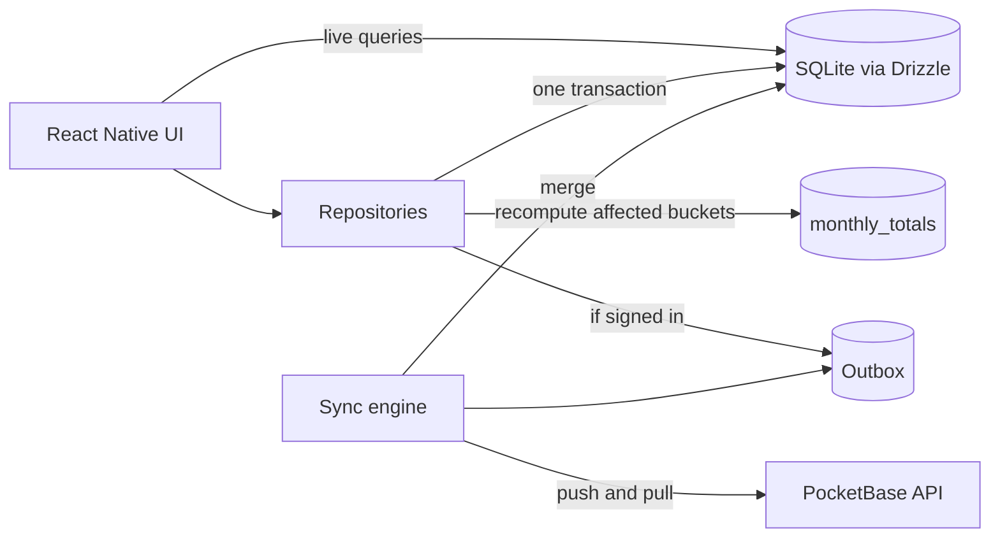

# Pennywick

**A fast, private expense tracker that works with no signup, no signal and no spreadsheet.**


<!-- Add after build: docs/media/demo.gif and 4 screenshots (home, add keypad, insights, budgets) -->

## Why this exists

Most people can tell you what they earned this month, but not where it went. Small cash and transfer spending (transport, airtime, food, power tokens) disappears because logging it takes too long. Pennywick makes logging a three-tap job and then does the boring part for you: totals, budgets and trends.

It works the moment you open it. No account is needed. If you want a backup or a second device, sign in later and your data syncs.

## Features

- Amount-first keypad entry: log an expense in about 3 taps
- Categories with icons (includes everyday Nigerian categories such as airtime and data, power, family support)
- Home screen with this month's spending, income and what is left
- Monthly budgets per category with progress and gentle warnings
- Insights: category breakdown, daily spending, comparison with last month
- Recurring entries (rent, subscriptions, salary) generated automatically
- Search and filter history, edit and delete with undo
- CSV export (spreadsheet-safe)
- Privacy mode that hides amounts; light and dark themes
- Optional account: backup and multi-device sync, with a sync status chip
- Everything works offline; money is stored as exact integers (no rounding drift)

## How it works

1. Every screen reads from local SQLite, so nothing waits on the network.
2. Every write updates the transaction and the cached monthly totals in one database transaction, so summaries are instant and always consistent.
3. If you sign in, an outbox pushes changes to the server with retries, and a pull merges changes from your other devices.

Full detail: [docs/architecture.md](docs/architecture.md).

## Tech stack

| Layer | Choice |
|---|---|
| App | React Native with Expo, TypeScript (strict), Expo Router |
| Local data | expo-sqlite with Drizzle ORM (live queries) |
| UI state | Zustand (UI-only state) |
| Lists, charts, motion | FlashList, react-native-svg (custom charts), Reanimated, Expo Haptics |
| Secure storage | expo-secure-store (auth token) |
| Connectivity | @react-native-community/netinfo |
| Export | expo-file-system and expo-sharing |
| Backend | PocketBase (single binary, SQLite) with custom hooks |
| Errors | Sentry SDK pointed at self-hosted GlitchTip (optional) |
| Tests | Jest |

Everything is free and self-hostable. No paid services, no analytics SDKs.

## Architecture



## Getting started

### Prerequisites

- Node.js LTS and npm
- Android emulator or a phone with Expo Go
- A PocketBase binary for your OS (pinned version in `backend/PB_VERSION`), only needed for the optional sync

### Run the app (local-only, no backend needed)

```bash
npm install
cp .env.example .env
npx expo start
```

### Run the backend (optional, for backup and sync)

```bash
cd backend
./pocketbase superuser create you@example.com 'choose-a-strong-password'
./pocketbase serve --http=0.0.0.0:8090
```

(On older PocketBase versions the command is `admin create`.) Migrations and hooks in `pb_migrations` and `pb_hooks` are applied automatically.

Set `EXPO_PUBLIC_API_URL` in `.env`:

| Device | URL |
|---|---|
| Android emulator | `http://10.0.2.2:8090` |
| Phone on the same Wi-Fi | `http://<your-computer-LAN-IP>:8090` |
| Phone over USB (after `adb reverse tcp:8090 tcp:8090`) | `http://localhost:8090` |

Use HTTPS for anything beyond local demos.

### Scripts

| Command | Purpose |
|---|---|
| `npm start` | Start Expo |
| `npm test` | Run unit and integration tests |
| `npm run typecheck` | TypeScript check |
| `npm run lint` | ESLint |
| `npm run db:generate` | Generate a Drizzle migration after schema changes |

## Project structure

```text
pennywick/
  app/                 Expo Router routes (screens only)
  src/
    db/                Drizzle schema, migrations, repositories, aggregates
    domain/            money, dates, recurrence, budgets (pure logic)
    sync/              Outbox, engine, push, pull, backoff, merge
    api/               PocketBase client, auth, error mapping
    features/          Screen components and hooks by feature
    ui/                Design tokens, shared components, charts
    lib/               ids, clock, logger, csv
    data/              Default categories and currencies
  backend/
    pb_hooks/          Conflict guard and validation hooks
    pb_migrations/     Collections and API rules as code
  docs/                design, story, demo, prd, cursorcontext, architecture
```

## Testing

`npm test` covers money math, date helpers, recurrence generation, budget status, CSV escaping, aggregate consistency (cached totals equal a brute-force recompute) and the sync engine against a fake server with injected failures. Manual scenarios are in [docs/architecture.md](docs/architecture.md#14-testing-strategy).

## Known limitations

- One currency per account
- The local database is not encrypted at rest; an optional app lock protects the UI only
- Last-write-wins per record; a rare edit of the same transaction on two devices keeps the later edit
- No bank or SMS import (intentionally, for privacy and store-policy reasons)
- No push notifications
- Single-node PocketBase

## Roadmap

- Local notifications at 80% and 100% of a budget
- Receipt photo attachment
- Encryption at rest
- Multiple currencies per account
- Backend move to Go or Python with Postgres using the same push and pull protocol

## Documentation

| Doc | Contents |
|---|---|
| [prd.md](docs/prd.md) | Problem, scope, user stories, acceptance criteria |
| [design.md](docs/design.md) | UI/UX, tokens, screens, patterns replicated |
| [architecture.md](docs/architecture.md) | Data model, derived data, recurrence, sync, errors, performance |
| [story.md](docs/story.md) | The narrative and interview talking points |
| [demo.md](docs/demo.md) | Demo script and recording guide |
| [cursorcontext.md](docs/cursorcontext.md) | Instructions for the AI coding agent |

## License

MIT