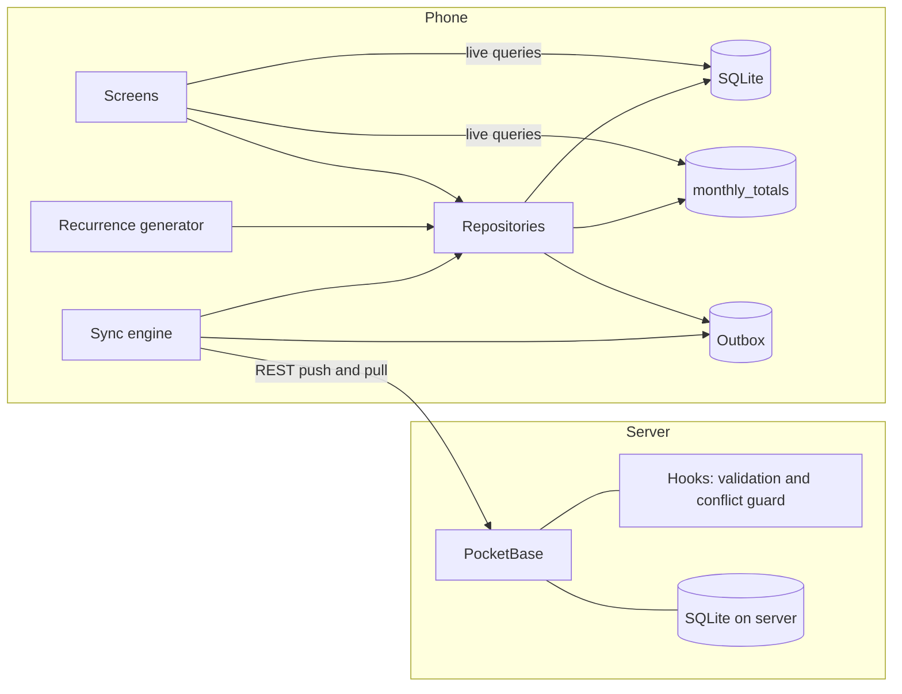

# Pennywick: Architecture

## 1. Overview and principles

Pennywick is local-first. The device database is the source of truth. The server is an optional backup and sync target for one user across devices.

| Principle | Where it lives |
|---|---|
| Offline-first, local DB as source of truth | `src/db`, all reads via live queries |
| Cached derived data kept consistent | `monthly_totals`, `src/db/aggregates.ts`, same-transaction recompute |
| Exact money | Integer minor units, `src/domain/money.ts` |
| Optimistic UI | Repositories commit locally; UI updates from live queries |
| Queue-and-retry writes | `src/sync/outbox.ts`, `push.ts`, `backoff.ts` (only when signed in) |
| Idempotency | Client IDs, deterministic IDs for seeds and recurring entries |
| Graceful degradation | App fully usable without network or account |
| Error handling and resilience | Error taxonomy, parked ops, route error boundaries |
| Secure storage | `expo-secure-store` for tokens; owner-scoped server rules |
| Perceived performance | Cached aggregates, virtualized History, deferred startup work |
| Observability | Logger interface with optional GlitchTip implementation |

## 2. System context



## 3. Client architecture

Layers: **routes** (`app/`), **features** (hooks and components), **domain** (pure logic), **repositories** and **database**, with **sync** and **api** as the only network users. Dependencies point downward.

State separation:
- Persistent data: SQLite
- UI-only state: Zustand (toasts, sheets, theme, privacy flag cache)
- Sync status: derived from NetInfo, engine state, outbox counts, and whether the user is signed in

## 4. Local data model

Timestamps are integer milliseconds since epoch. Amounts are integer minor units (kobo or cents).

```sql
CREATE TABLE categories (
  id TEXT PRIMARY KEY,
  name TEXT NOT NULL,
  kind TEXT NOT NULL CHECK (kind IN ('expense','income')),
  icon TEXT NOT NULL,
  color_key TEXT NOT NULL,              -- token name like 'cat3'
  sort_order REAL NOT NULL DEFAULT 0,
  archived INTEGER NOT NULL DEFAULT 0,
  is_seed INTEGER NOT NULL DEFAULT 0,
  updated_at INTEGER NOT NULL,
  deleted_at INTEGER
);

CREATE TABLE transactions (
  id TEXT PRIMARY KEY,
  kind TEXT NOT NULL CHECK (kind IN ('expense','income')),
  amount_minor INTEGER NOT NULL CHECK (amount_minor > 0),
  category_id TEXT NOT NULL REFERENCES categories(id),
  occurred_on TEXT NOT NULL,            -- local date YYYY-MM-DD
  month_key TEXT NOT NULL,              -- YYYY-MM, derived from occurred_on
  note TEXT,
  recurring_rule_id TEXT,
  created_at INTEGER NOT NULL,
  updated_at INTEGER NOT NULL,
  deleted_at INTEGER
);
CREATE INDEX idx_tx_date ON transactions(deleted_at, occurred_on DESC);
CREATE INDEX idx_tx_month_cat ON transactions(month_key, category_id, kind, deleted_at);

CREATE TABLE budgets (
  id TEXT PRIMARY KEY,
  category_id TEXT NOT NULL REFERENCES categories(id),
  limit_minor INTEGER NOT NULL CHECK (limit_minor > 0),
  updated_at INTEGER NOT NULL,
  deleted_at INTEGER
);
-- one active budget per category enforced in the repository

CREATE TABLE recurring_rules (
  id TEXT PRIMARY KEY,
  kind TEXT NOT NULL CHECK (kind IN ('expense','income')),
  amount_minor INTEGER NOT NULL CHECK (amount_minor > 0),
  category_id TEXT NOT NULL REFERENCES categories(id),
  note TEXT,
  frequency TEXT NOT NULL CHECK (frequency IN ('weekly','monthly')),
  day INTEGER NOT NULL,                 -- weekday 1..7 (Mon=1) or day of month 1..31
  start_on TEXT NOT NULL,
  last_generated_on TEXT,
  active INTEGER NOT NULL DEFAULT 1,
  updated_at INTEGER NOT NULL,
  deleted_at INTEGER
);

-- Local-only derived cache, never synced
CREATE TABLE monthly_totals (
  month_key TEXT NOT NULL,
  category_id TEXT NOT NULL,
  kind TEXT NOT NULL,
  total_minor INTEGER NOT NULL,
  entry_count INTEGER NOT NULL,
  PRIMARY KEY (month_key, category_id, kind)
);

CREATE TABLE settings (
  key TEXT PRIMARY KEY,                 -- currency, theme, privacy, sync_owner_id, last_recurring_run
  value TEXT NOT NULL
);

CREATE TABLE outbox (
  seq INTEGER PRIMARY KEY AUTOINCREMENT,
  entity TEXT NOT NULL CHECK (entity IN ('category','transaction','budget','recurring_rule')),
  entity_id TEXT NOT NULL,
  op TEXT NOT NULL CHECK (op IN ('create','update','delete')),
  payload TEXT NOT NULL,
  attempts INTEGER NOT NULL DEFAULT 0,
  next_attempt_at INTEGER NOT NULL DEFAULT 0,
  status TEXT NOT NULL DEFAULT 'pending' CHECK (status IN ('pending','parked')),
  last_error TEXT,
  created_at INTEGER NOT NULL
);

CREATE TABLE sync_state (
  key TEXT PRIMARY KEY,                 -- cursor per collection
  value TEXT NOT NULL
);
```

Notes:
- Foreign keys on; migrations generated by `drizzle-kit` and applied at startup.
- `monthly_totals` rows with zero count are deleted during recompute.
- The outbox is only written when the user is signed in. On first sign-in, an initial enqueue walks local data (section 6.6).

## 5. Derived data and consistency

### 5.1 The rule

Every transaction write (create, edit, delete, undo, sync merge, recurring generation) runs in one database transaction that also recomputes the affected cache buckets.

### 5.2 Affected bucket keys

A bucket key is (`month_key`, `category_id`, `kind`).

| Operation | Affected keys |
|---|---|
| Create | The new row's key |
| Edit | The old key and the new key (if month, category or kind changed) |
| Delete or undo | The row's key |
| Sync merge of a record | Its previous local key (if it existed) and its new key |

### 5.3 Recompute

```sql
-- per affected key
SELECT COALESCE(SUM(amount_minor),0) AS total, COUNT(*) AS n
FROM transactions
WHERE month_key = ? AND category_id = ? AND kind = ? AND deleted_at IS NULL;
```

Upsert the result, or delete the bucket row if `n = 0`. Recomputing from source (instead of applying a delta) is idempotent, handles every operation uniformly, and cannot drift from repeated retries.

### 5.4 Consumers

| Screen | Reads from |
|---|---|
| Home hero, top categories, Budgets | `monthly_totals` |
| Insights donut and comparison | `monthly_totals` |
| Insights daily bars | Indexed `transactions` query grouped by `occurred_on` for the month |
| History | `transactions` |

### 5.5 Oracle and repair

`rebuildAll()` recomputes every bucket from scratch. It is used (a) as the test oracle, (b) after a bulk sync import, and (c) as a hidden repair action. A test runs 1,000 random operations and asserts the cache equals `rebuildAll()`.

## 6. Sync (optional, only when signed in)

This is the Hearthlist design generalized; reuse that code where available.

### 6.1 Account model
- Not signed in: no outbox rows are written, no network calls are made.
- Signed in: every write also inserts an outbox row in the same transaction.
- `sync_owner_id` records which account the local data is tied to. Signing in as a different user prompts: replace local data (wipe tables, reseed, pull) or cancel.

### 6.2 Write path
Repository transaction (entity change, bucket recompute, outbox insert), live queries emit instantly, `requestSync()` is debounced.

### 6.3 Coalescing
| Sequence | Result |
|---|---|
| create then updates | One create with final state |
| updates then updates | One update with the latest values |
| create then delete (never synced) | Both dropped |
| updates then delete | One delete |

### 6.4 Drain and errors
Process by `seq` with dependency order (categories, rules, budgets, then transactions). Backoff: min(300 s, 2 s * 2^attempts) with plus or minus 20% jitter, reset on connectivity regained or foreground. Error handling is in section 9. Stop the drain on retryable errors to preserve order.

### 6.5 Pull and merge
- Cursor per collection in `sync_state`; request `updated >= cursor`, sorted `updated,id`, 200 per page
- Apply each page in one transaction; skip records with pending outbox ops; apply server tombstones as `deleted_at`
- Recompute affected buckets in the same transaction
- Trigger pulls on foreground, connectivity regained, after a successful drain, and on manual refresh (no realtime in this app; single user)

### 6.6 First sign-in
1. Enqueue creates for all non-deleted local records except unmodified seed categories (seeds whose `updated_at` equals install time and `is_seed = 1`).
2. Push, then pull.
3. Seeded categories share fixed IDs across devices, so a second device's seeds merge instead of duplicating.

### 6.7 Conflicts
Single LWW timestamp per record. The server clamps timestamps more than 5 minutes in the future and returns 409 `stale_write` for older writes; the client then applies the server record. Delete is a tombstone with its own `updated_at`; a later edit resurrects a record, a later delete removes it. Clock skew can lose ties (documented limitation).

### 6.8 Sync status
Not signed in: no chip. Signed in: Offline, Syncing, Issue (parked ops or auth needed), Pending, Up to date.

## 7. Recurrence

### 7.1 Generation
On app start (after first interactive render) and on foreground:

1. Load active rules.
2. For each rule, compute occurrence dates from `last_generated_on` (exclusive) or `start_on` (inclusive) through today (local), capped at 366 per run.
3. For each occurrence create a transaction with deterministic ID `rc` + first 13 hex chars of SHA-256(`ruleId:YYYY-MM-DD`), `recurring_rule_id` set, inside the standard repository transaction.
4. If an ID already exists (including soft-deleted), skip it, so a deleted occurrence is not regenerated.
5. Update `last_generated_on` to the latest processed date.

### 7.2 Date rules
- Weekly: every occurrence whose weekday matches `day` (Monday = 1)
- Monthly: `day` clamped to the month's last day (31 in February becomes 28 or 29)
- Edits to a rule affect future occurrences only; already generated entries are unchanged

### 7.3 Why deterministic IDs
Two devices (or a crash and retry) can generate the same occurrence; the same ID makes the creates idempotent on the server and merges cleanly on pull.

## 8. Backend (PocketBase)

Pin the PocketBase version in `backend/PB_VERSION` and read its docs before writing hooks. Verify field, rule and hook syntax against that version.

### 8.1 Collections
All four collections carry an `owner` relation to `users` and a `client_updated_at` number (the LWW timestamp), plus `deleted_at` (number, optional). PocketBase `created` and `updated` autodates exist; `updated` is the pull cursor.

| Collection | Fields |
|---|---|
| `categories` | `name`, `kind`, `icon`, `color_key`, `sort_order`, `archived`, `is_seed` |
| `transactions` | `kind`, `amount_minor` (number, integer, above 0), `category` (text id), `occurred_on` (text, `YYYY-MM-DD`), `month_key`, `note` (up to 280), `recurring_rule_id` |
| `budgets` | `category` (text id), `limit_minor` |
| `recurring_rules` | `kind`, `amount_minor`, `category`, `note`, `frequency`, `day`, `start_on`, `last_generated_on`, `active` |

Category references are stored as text IDs (not relations) so pushes do not fail on ordering; the client's dependency order keeps them consistent.

### 8.2 API rules (starting point; test in the Admin UI rule tester)

| Operation | Rule |
|---|---|
| List and view | `@request.auth.id != "" && owner = @request.auth.id` |
| Create | `@request.auth.id != "" && @request.body.owner = @request.auth.id` |
| Update | `@request.auth.id != "" && owner = @request.auth.id && @request.body.owner:isset = false` |
| Delete | none (soft delete only) |

### 8.3 Hooks
- Validation on create and update: `amount_minor` is an integer above 0 and below a sane maximum, `occurred_on` matches `YYYY-MM-DD` and is a real date, `month_key` equals `occurred_on` first 7 characters, text lengths within limits
- Conflict guard on update: clamp `client_updated_at` to server now if more than 5 minutes ahead; if the submitted `client_updated_at` is older than the stored one, respond 409 `stale_write` with the current record
- Create with an existing client ID returns the existing-record error that the client treats as success after a GET (verify the exact PocketBase behavior for custom IDs in the pinned version)

### 8.4 Operations
- Run locally with `./pocketbase serve --http=0.0.0.0:8090`
- Commit `pb_migrations`; use PocketBase backups for any hosted instance
- HTTPS required beyond local demos

## 9. Error handling

| Class | Examples | Retry | User sees | Log |
|---|---|---|---|---|
| network | fetch failed, timeout | Yes, backoff | Chip: Offline or Pending (signed in only) | breadcrumb |
| transient | 5xx, 429 (respect Retry-After) | Yes, backoff | Chip: Pending | warn |
| auth | 401 | Refresh once, then park and prompt | Banner: "Sign in again to resume backup" | info |
| forbidden | 403 | No, park | Sync center entry | error |
| validation | 400, 422 | No, park | Sync center entry with plain reason | error (ids only) |
| conflict | 409 `stale_write` | Resolved by applying server record | Nothing | info |
| notFound | 404 on delete | Treated as success | Nothing | debug |
| local | SQLite failure | No | Recovery screen with Restart | error |
| unknown | JS exceptions | n/a | Route-level error boundary | error |

Rules: never show raw error text; never log amounts, notes or emails; never clear local data because of a network or auth error.

Local validation: amount must be above zero and within limits, category must exist and not be archived for new entries, dates must be valid. Validation failures show inline field messages.

## 10. Money, dates and formatting

- **Parsing:** keypad produces a string; `parseAmount` converts to minor units using the currency's decimals (all supported currencies use 2); reject more than 2 decimal places and more than 12 integer digits
- **Formatting:** own formatter: group thousands, show the symbol or code, tabular digits; `Intl` is used only if verified on the target Hermes build
- **Totals:** sums are integer sums; percentages for display use rounded integer math at the edge
- **Dates:** local calendar dates via `src/domain/dates.ts`; month boundaries and "today" from local time; weeks start Monday; changing the device timezone does not move existing entries
- **Currency:** one per account, set at onboarding; changing it does not convert amounts (warned in UI)

## 11. Performance plan

| Concern | Approach |
|---|---|
| Startup | Defer sync boot, recurrence catch-up and suggestion queries until after the first interactive frame; no heavy work at module load; Hermes enabled |
| Summaries | Read from `monthly_totals` (O(buckets)); recompute only affected buckets |
| History | FlashList over a flattened array, memoized rows, stable keys, paged live query window if 5,000 rows is slow |
| Writes | One transaction per user action |
| Charts | Custom SVG, render only when focused, memoized geometry |
| Bundle | No chart library, no image assets, system fonts |
| Measurement | Release build on a low-end device with the 5,000-entry demo dataset; cold start via `adb shell am start -W`; scroll via perf monitor; APK size from the build output |

Budgets: cold start under 2 s, 60 fps History at 5,000 entries, save under 100 ms, APK under 40 MB.

## 12. Security and privacy

- Token in `expo-secure-store`; never logged
- No analytics SDKs; nothing leaves the device unless the user signs in
- Owner-scoped API rules; verified by a manual cross-account test
- HTTPS for non-local use
- CSV export neutralizes formula injection and quotes all text fields
- Privacy mode masks amounts in the UI and in the app switcher snapshot where the platform allows (verify)
- Optional app lock protects the UI only; the local database is not encrypted at rest (documented limitation)
- Account guard prevents merging two people's finances on one phone
- No secrets in the repo; `EXPO_PUBLIC_*` variables are public and contain only the API URL and optional error DSN

## 13. Observability

- `logger` interface with console and optional Sentry (GlitchTip DSN) implementations
- Breadcrumbs for sync events and recurrence runs with ids and counts only
- Sync center is the in-app diagnostic view
- PocketBase admin logs for server issues

## 14. Testing strategy

**Unit (Jest):** money parsing and formatting, date helpers (month ends, leap years, week start), recurrence generation, budget status thresholds, insights math (shares, percent change, top 8 plus Other), CSV escaping and injection, backoff, coalescing, merge, clock monotonicity, error mapping.

**Aggregate consistency:** 1,000 random operations (add, edit amount, edit category, edit date across months, delete, undo, sync merge) with assertion that `monthly_totals` equals `rebuildAll()` after each batch.

**Integration:** sync engine against a fake server with injected failures (network, 500, 429, 401, 409, duplicate create, crash between success and outbox delete).

**Manual matrix:**

| # | Scenario | Expected |
|---|---|---|
| 1 | Fresh install, airplane mode, add 20 entries | All saved; Home totals correct; no network calls |
| 2 | Edit an entry from November to October | Both months' totals update |
| 3 | Delete then Undo | Totals return to the original values |
| 4 | Rule on day 31, run in February | Entry on the last day of February |
| 5 | Launch after 40 days of inactivity with a monthly rule | Missing occurrences created once each |
| 6 | Run recurrence twice | No duplicates |
| 7 | Sign in on device A, then B | B shows identical entries, budgets, categories and totals |
| 8 | A adds entries offline, then reconnects | They appear on B; none lost or duplicated |
| 9 | Kill the app mid-sync | Resumes; no loss or duplicates |
| 10 | Sign in as a different account on a used phone | Replace-or-cancel prompt appears |
| 11 | Export with a note starting with `=1+1` | Cell is neutralized |
| 12 | Cross-account API request | Rejected |
| 13 | 5,000 entries in History | Smooth scroll at the target frame rate |
| 14 | Travel timezone change (set device timezone back and forth) | Existing entries stay on their dates |

## 15. Architecture decision records

| ADR | Decision | Alternatives | Why |
|---|---|---|---|
| 1 | Integer minor units | Floats, decimal library | Exact, simple, fast |
| 2 | Local date string plus `month_key` | UTC timestamps | Spending belongs to the user's local day |
| 3 | Cached `monthly_totals` recomputed per affected bucket | Delta updates, on-demand queries | Idempotent, uniform for edits, deletes and merges; instant summaries |
| 4 | Optional account | Mandatory signup | Time-to-value and privacy |
| 5 | Reuse Hearthlist outbox sync | PowerSync, new design | Proven, free, explainable |
| 6 | Single LWW timestamp per record | Field groups, CRDTs | Single-user data; low conflict risk |
| 7 | Deterministic IDs for seeds and recurring entries | Random IDs | Cross-device idempotency |
| 8 | Custom SVG charts | Chart library | Smaller bundle, full control |
| 9 | No SMS or bank import | SMS parsing | Privacy, store policy and fragility |
| 10 | Soft deletes | Hard deletes | Deletions must propagate |

## 16. Scaling limits and upgrade path

PocketBase is a single node with SQLite: fine for personal data at portfolio scale. To scale, reimplement the push, pull and cursor protocol as a Go or Python service on Postgres with row-level security per owner. The client's repositories, outbox and merge stay the same; only the API adapter and server-side guard change.

## 17. Open questions

- Does the pinned PocketBase version accept client-supplied IDs on create, and what does it return for duplicates?
- Does `Intl` currency formatting behave on the target Hermes build, or is the custom formatter the only path?
- Can SQLite tests run under Jest in this setup, or should the consistency test use an in-memory model of the same SQL semantics?
- Should budgets carry over unspent amounts in a future version?